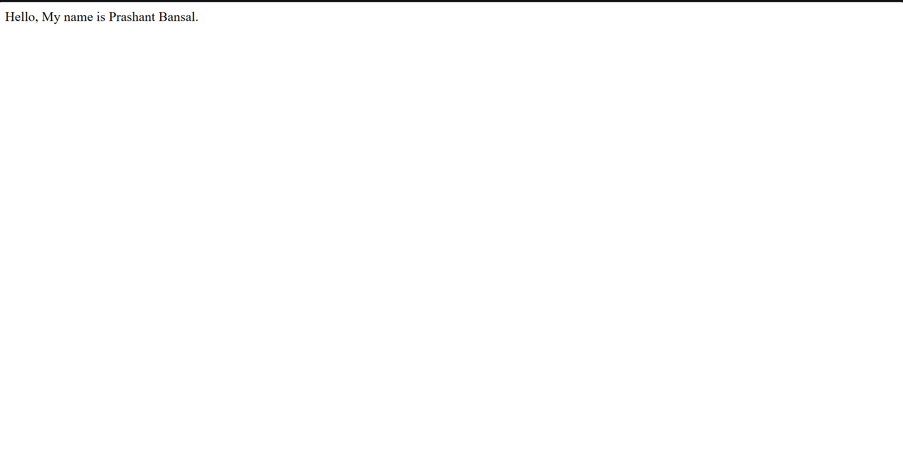

# dev-learning

> My public learning log on the way to becoming a full-stack developer.



## Why this repo exists

I am following a structured full-stack roadmap (MERN and beyond). This
repository holds my daily exercises, notes, and mini projects, with a
commit trail that shows the work.

## Tools

Git and GitHub, VS Code, Node.js and npm, the terminal (Git Bash).

## Structure

| Week     | Folder       | Topic                                |
| -------- | ------------ | ------------------------------------ |
| 1, Day 1 | `week1/day1` | Environment, terminal, first scripts |
| 1, Day 2 | `week1/day2` | Git fundamentals, first push         |
| 1, Day 3 | `week1/day3` | Branching, merging, pull requests    |
| 1, Day 4 | `week1/day4` | Merge conflicts, stash, README       |

## Getting started

```bash
git clone https://github.com/prashantbansal2003/dev-learning.git
cd dev-learning
node week1/day1/scripts/hello.js
```

## Progress

- [x] Week 1: environment and Git
- [ ] Week 1: HTML5 and first deployment
- [ ] Week 2: CSS

## Contact

Built by [Prashant Bansal](https://github.com/prashantbansal2003).

## License
